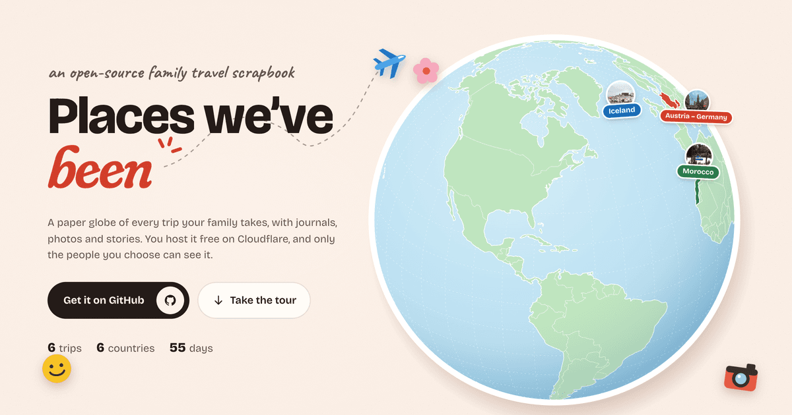

# Places We've Been: the landing page

The landing page for [Places We've Been](https://github.com/kimchi11y/places-weve-been), an open-source family travel scrapbook. It tells the story as you scroll: the paper globe tours the example trips, a journal spills its photos onto the table, a photo loses its hidden location, and the page ends with how to set it up yourself.



```sh
npm install
npm run dev      # http://localhost:4321
npm run build    # into dist/
```

## How it's made

- **Astro**, built to plain static files
- **GSAP** (ScrollTrigger, Draggable, SplitText, MotionPath) for the scroll scenes, and **Lenis** for smooth scrolling
- **d3-geo** for the globe, a lighter copy of the app's engine (`src/scripts/globe.ts`) that scrolling can steer
- With *reduce motion* turned on, the smooth scrolling, intro and drifting stickers are off, and the globe stays still until you scroll

| Path | What it is |
|---|---|
| `src/pages/index.astro` | Every section of the page |
| `src/scripts/main.ts` | The scroll scenes, one function per section |
| `src/scripts/globe.ts` | The paper globe |
| `src/data/trips.ts` | The app's six example trips |
| `src/styles/tokens.css` | Colours, fonts, stickers and stamps, shared with the app |
| `scripts/photos.mjs` | Makes `public/img/` from the app's example photos and screenshots |

## Photos

Only the app's example photos are used. They're public domain, from Wikimedia Commons (see [`PHOTO-CREDITS.md`](PHOTO-CREDITS.md)). To remake them, with the app checked out next to this folder:

```sh
npm run photos -- ../places-weve-been
```

## Deploying

It's served as static files by a Cloudflare Worker (`wrangler.jsonc`). In the Cloudflare dashboard, **Workers & Pages → Create → Import a repository**, then set the build command to `npm run build` and the deploy command to `npm run deploy`. Or from here: `npx wrangler login`, then `npm run build && npm run deploy`.

## Licence

MIT: see [`LICENSE`](LICENSE).
